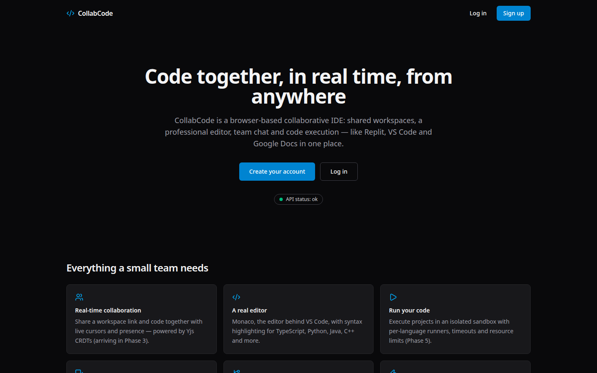
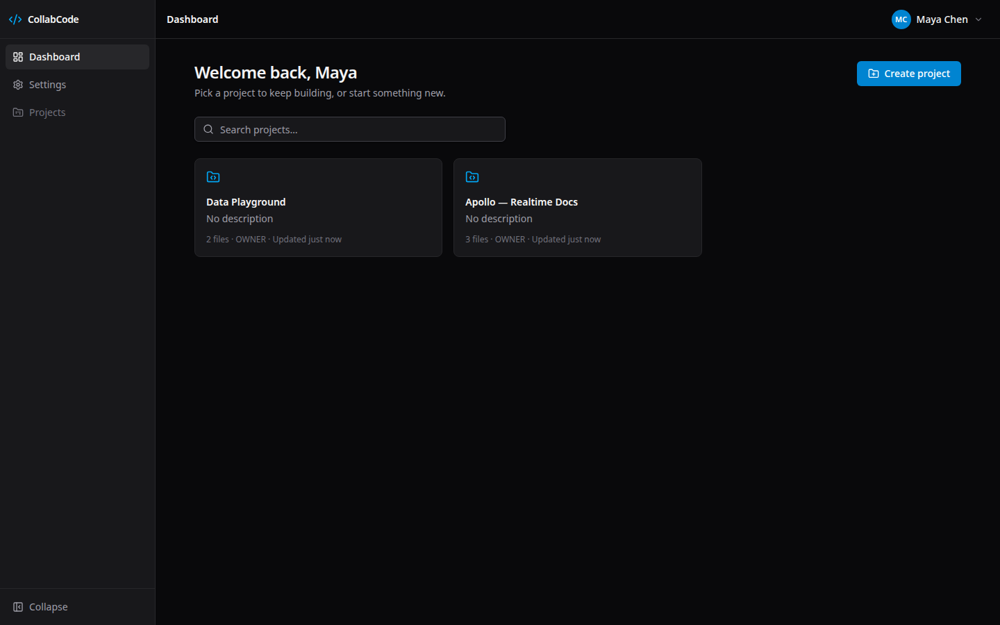
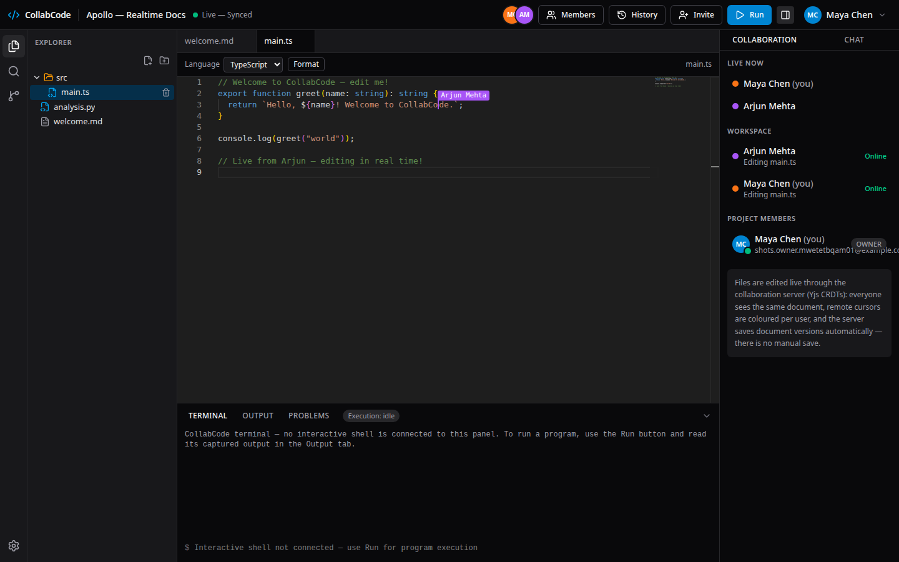
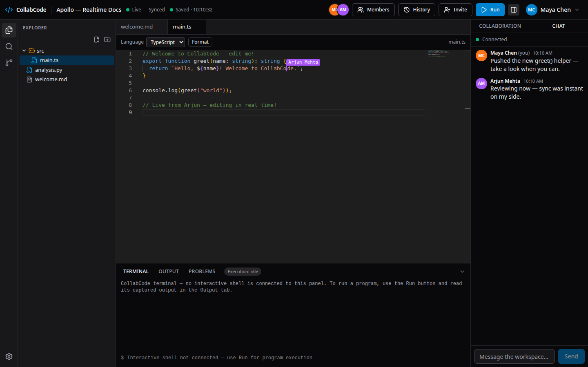
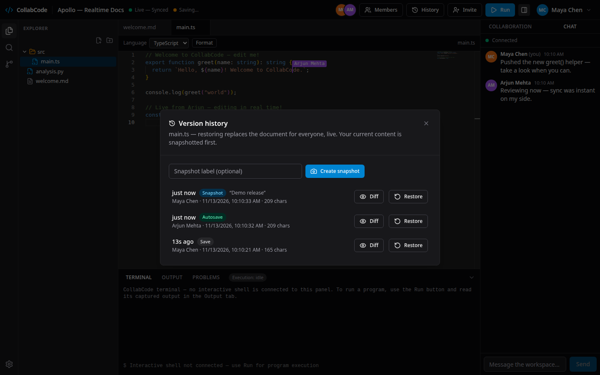
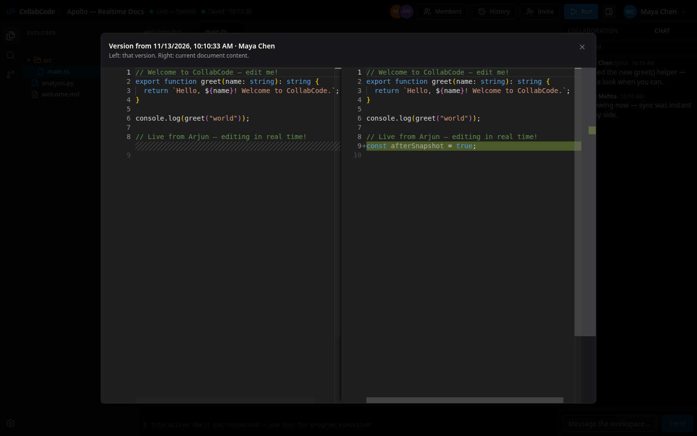
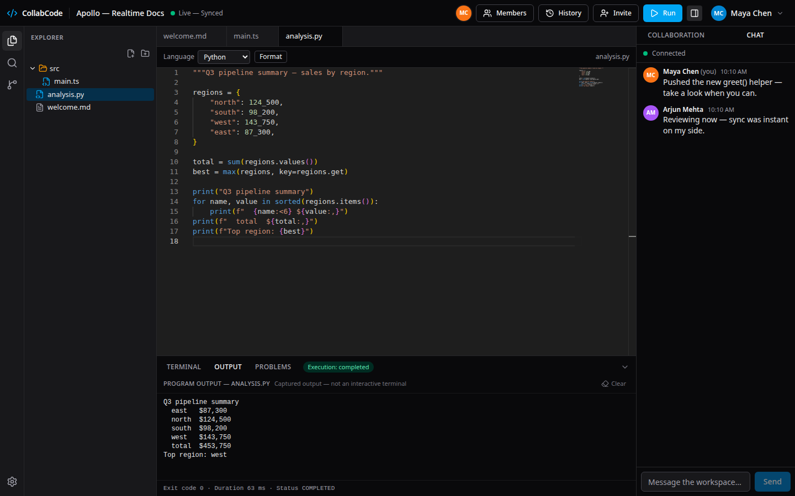
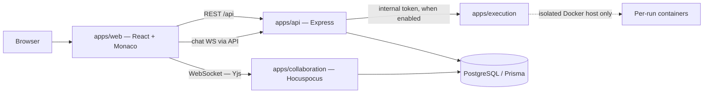

# CollabCode

A real-time collaborative IDE in the browser — shared workspaces, a Monaco
editor with live cursors, team chat, version history, and sandboxed code
execution. Think Replit + VS Code + Google Docs, built as a typed pnpm
monorepo with four services and a real PostgreSQL backend. No mock data
anywhere: every screen runs against the live API, and every claim in this
README is backed by the test suites (275 unit/integration tests + 7
Playwright E2E scenarios, all passing).

## Live demo

> **Placeholder — links are added here once the deployment is verified.**
> The hosted demo runs with **code execution disabled** (see
> [Execution security model](#execution-security-model)); everything else —
> accounts, workspaces, real-time editing, chat, invitations, version
> history — is fully live. Deployment runbook: [docs/deployment.md](docs/deployment.md).

## Features

- **Auth & accounts** — Argon2id password hashing, httpOnly cookie sessions
  (15-minute JWT access + 7-day opaque refresh with rotation and
  reuse-revokes-all), CSRF double-submit protection, rate limiting.
- **Projects & files** — workspaces with OWNER / EDITOR / VIEWER roles
  (non-members get 404s, never a leak), file tree with server-computed
  paths, traversal-proof names.
- **Real-time collaborative editing** — Yjs CRDT documents over Hocuspocus:
  simultaneous editing with no locks, remote cursors/selections, live
  presence, offline edits that merge on reconnect.
- **Persistence & version history** — Yjs state persisted to PostgreSQL with
  retry/backoff, a pending-store sweeper and server-acknowledged save
  status; every file has a version timeline (autosaves, saves, labelled
  snapshots) with a Monaco diff viewer and one-click restore *through the
  live document*.
- **Team chat & invitations** — per-workspace real-time chat (WebSocket
  gateway, persisted history, cursor pagination) and email-bound,
  hash-only invitation links (accept-to-join; nobody is a member before
  accepting).
- **Code execution** — JavaScript, Python and C++ runs in a dedicated
  internal-only service (Docker sandbox in production; see the security
  model below). Disabled in the public demo by policy.
- **Engineering hygiene** — strict TypeScript everywhere, Zod validation at
  every boundary, structured request IDs, OpenAPI spec, CSP/security
  headers, ESLint at 0 errors, CI workflow (lint → typecheck → test → build
  → E2E).

## Screenshots

Captured from the real running app (production web build, two live users)
by `apps/e2e/screenshots.mjs` — see [docs/screenshots/](docs/screenshots/).


*Landing page with live API health indicator.*


*Project dashboard.*


*Two users editing one file — note the remote cursor flag and live presence panel.*


*Workspace chat.*


*Version history with sources and labels.*


*Diffing a snapshot against the live document.*


*A Python run with captured output, exit code and duration (local stack — execution is disabled in the hosted demo).*

## Architecture



| Service | Port (local) | Responsibility |
|---|---|---|
| `apps/web` | 5173 | React SPA: landing, auth, dashboard, workspace IDE, settings |
| `apps/api` | 4000 | REST API + chat WebSocket gateway + collab-token minting |
| `apps/collaboration` | 4001 (WS) + 4003 (health) | Yjs sync, awareness, persistence, version sync-back, restore |
| `apps/execution` | 4002 | Internal-only code execution (never exposed publicly) |
| `packages/shared` | — | Shared types, response envelope, health, env helpers |
| `packages/config` | — | Shared tsconfig / ESLint / Prettier bases |
| `apps/e2e` | — | Playwright end-to-end suite + screenshot capture |

Full design: [docs/architecture.md](docs/architecture.md),
[docs/collaboration.md](docs/collaboration.md).

## Tech stack

- **Frontend:** React 18, TypeScript, Vite 6, Tailwind CSS v4, Zustand,
  Monaco Editor (`y-monaco` binding), React Router 7.
- **Backend:** Node.js, Express, Prisma ORM, PostgreSQL, Zod, Argon2id,
  `ws` (chat gateway), Hocuspocus + Yjs (collaboration).
- **Execution:** dedicated service with pluggable runners — DockerRunner
  (production) / SubprocessRunner (dev/test only).
- **Tooling:** pnpm 10 workspaces, Vitest, Playwright, ESLint, Prettier,
  GitHub Actions CI.

## System design

- **Three trust boundaries.** The browser holds no secrets and no database
  credentials. The API is the only public backend surface; the execution
  service accepts calls only from the API (shared-secret header, no public
  route); the collaboration server independently re-verifies membership
  against PostgreSQL on every connection — a token alone is never trusted
  for authorization.
- **Two kinds of real-time.** Document editing uses Yjs sync (state-based
  CRDT updates, server as relay + persistence point). Chat and workspace
  presence use a separate, simpler WebSocket gateway on the API, because
  chat messages are append-only records, not CRDT state.
- **Durability over optimism.** Chat messages are broadcast only after they
  are persisted. Document stores retry with backoff, park (never drop) on
  failure, and are retried by a sweeper; the editor's save indicator is
  driven by the server's persist acknowledgements, not by local hope.
- **Roles enforced server-side, twice.** OWNER > EDITOR > VIEWER is checked
  in the API for REST and again in the collaboration server (VIEWER
  connections are made read-only at the protocol level).

## Database schema overview

PostgreSQL via Prisma (canonical schema in `apps/api/prisma/schema.prisma`):
`User`, `RefreshToken` (hash-only, rotation), `Project`, `ProjectMember`,
`Invitation` (hash-only token, lazy expiry), `File` (self-referencing tree),
`DocumentVersion` (content + `source`/`label`), `YjsDocument` (binary CRDT
state per file), `ChatMessage`, `Execution`. Details and migrations:
[docs/database.md](docs/database.md).

## Real-time collaboration

Documents are named `project:<projectId>:file:<fileId>`. The flow:

1. The browser asks the API for a 10-minute collab JWT
   (`POST /api/collab/token`, cookie auth; non-members get 404).
2. The collaboration server verifies the JWT, then re-checks the file, the
   project match and the membership row in PostgreSQL, and derives
   read-only from the **database role**, not the token.
3. The document loads from `YjsDocument` (or seeds from the latest version
   exactly once), syncs via Yjs, and persists debounced (2 s idle / 10 s
   max) with retry + sweeper; plain text syncs back into
   `DocumentVersion` (throttled) so REST downloads and history stay
   truthful.

Details: [docs/collaboration.md](docs/collaboration.md),
[docs/persistence.md](docs/persistence.md).

## Why CRDTs (and not last-write-wins)

With last-write-wins, two users typing in the same paragraph overwrite each
other: whichever save lands last silently deletes the other's characters.
Operational transform avoids that but needs a central server to transform
every operation against concurrent ones — complex and hard to make
offline-tolerant. CollabCode uses **Yjs**, a CRDT (conflict-free replicated
data type): every edit is a small, uniquely-identified update that can be
applied in any order, on any replica, and all replicas **converge to the
identical document** — proven in the test suite by 5 clients × 40
interleaved lines converging byte-identically. CRDTs also give offline
editing for free (updates queue locally and merge on reconnect) and make
the server a relay/persistence point instead of a bottleneck that must
understand every keystroke.

## Execution security model

Running strangers' code is the most dangerous feature in the product, so it
is isolated and **off by default in the hosted deployment**:

- A dedicated service, reachable only by the API via a shared secret.
- Production runs use one hardened `docker run` per step: no network,
  256 MB memory/CPU caps, PID limits, non-root user, all capabilities
  dropped, read-only root filesystem, fixed language images only
  (`node:20-alpine`, `python:3.12-alpine`, `gcc:13-bookworm`) — command
  lines are constructed as argv arrays, never through a shell.
- The subprocess fallback has **no isolation** and refuses to boot in
  production.
- The Docker path is implemented and unit-tested but was not live-verified
  during development (no Docker host), so the public demo runs with
  `EXECUTION_SERVICE_URL` unset → the API answers
  `503 EXECUTION_DISABLED` and the UI shows a calm notice. Execution is
  enabled only after the Docker-host checklist passes.

Full model: [docs/execution-security.md](docs/execution-security.md),
[docs/execution.md](docs/execution.md).

## Local setup

Prerequisites: Node ≥ 20, pnpm 10. PostgreSQL via the bundled embedded
server (no system install needed) or your own.

```bash
pnpm install --frozen-lockfile

# Database (embedded Postgres on :55433):
node apps/api/scripts/dev-db.mjs start
# (collab tests use a second instance on :55434 — see docs/testing.md)

cp .env.example .env        # per-app .env.example files exist too
pnpm db:generate            # generate the Prisma client (required before build)
pnpm -r build
pnpm --filter @collabcode/api db:deploy   # apply migrations

# Run the services (four terminals, or use the dev scripts):
pnpm --filter @collabcode/api dev           # :4000
pnpm --filter @collabcode/collaboration dev # :4001 / :4003
pnpm --filter @collabcode/execution dev     # :4002 (subprocess runner, dev only)
pnpm --filter @collabcode/web dev           # :5173
```

Open http://localhost:5173, register, create a project, invite a second
account (the dev invitation link is printed by the API's DevMailer log),
and edit the same file in two browsers.

A Docker Compose path (`docker-compose.yml` + `docker/*.Dockerfile`) is
provided for a production-shaped run; it has been reviewed structurally
but not live-run in the authoring sandbox (no Docker binary).

## Environment variables

Local development uses `.env.example` (development defaults are guarded:
every one of them is rejected when `NODE_ENV=production`). Production
configuration is documented per service — name, purpose, where it is set,
secret or not — in [`.env.production.example`](.env.production.example).
The critical production facts: `JWT_SECRET` and `COLLAB_INTERNAL_TOKEN`
must be **identical on the API and collaboration services**; CORS/allowed
origins are wired in a second pass once the web URL exists; leaving
`EXECUTION_SERVICE_URL` unset disables code execution.

## Testing

```bash
pnpm -r typecheck   # strict TS, 7 projects
pnpm -r test        # 275 tests: api 101 · web 93 · collab 48 · execution 28 · shared 5
pnpm --filter @collabcode/e2e test   # Playwright A–G, 7/7
```

Suites run against real PostgreSQL and real WebSockets (no mocked
database), including a database-outage recovery test and the 5-client
concurrency convergence test (median propagation 4–9 ms, p95 5–39 ms —
loopback figures). Full guide: [docs/testing.md](docs/testing.md);
security audit: [docs/qa-report.md](docs/qa-report.md).

## Deployment

Web on **Vercel** (`apps/web/vercel.json`), API + collaboration on
**Render** (`render.yaml` Blueprint + managed Postgres), two-pass
environment wiring, health checks at `/api/health/ready` (API) and
`/health` (collab, single-port mode). Step-by-step:
[docs/deployment.md](docs/deployment.md).

## Known limitations

Stated plainly, on purpose:

- **Docker execution path is not live-verified.** No Docker binary exists
  in the authoring sandbox; the runner's command lines are unit-tested
  only. Consequently the **public demo runs with execution disabled**
  until a Docker host passes the verification checklist.
- **Single-process in-memory state.** Workspace presence, chat rooms and
  collab throttle state live in one process per service; running multiple
  instances needs the future Redis backplane.
- **Invitations are dev-link by default.** No SMTP is bundled; with no
  mail server configured, invitation links are logged/returned by the API
  instead of emailed (an SMTP mailer configuration exists).
- **Monaco loads from a CDN** (jsDelivr) rather than being self-hosted.
- **Free-tier hosting caveats:** Render's free Postgres expires after
  ~30 days (Neon is the drop-in alternative) and free web services spin
  down when idle (first request can take ~ a minute).
- **Dependency audit pending:** `pnpm audit` could not run in the sandbox
  (network proxy resets the audit endpoint) — it runs in CI.
- Chat has no edit/delete/reactions; presence does not yet show *which
  line* a workspace member is on outside the open document.
