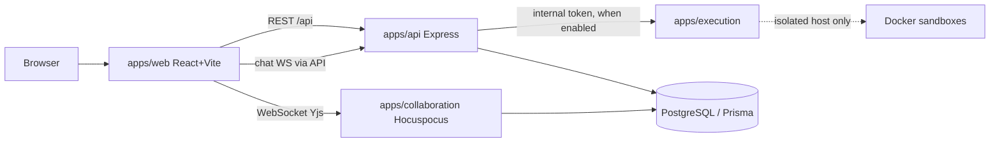
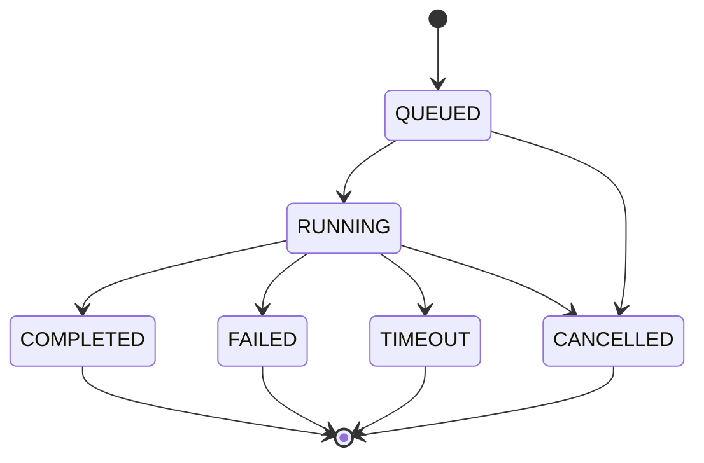
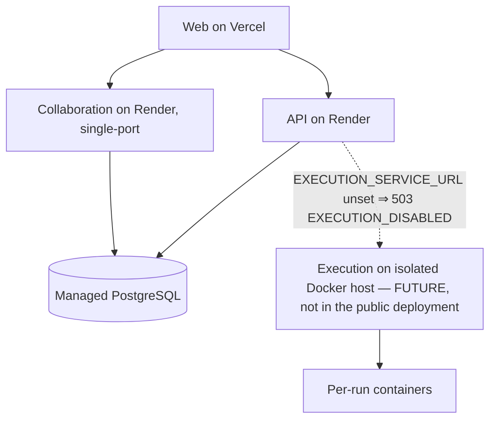

# CollabCode — Architecture

## Ports
| Service | Port | Notes |
|---|---|---|
| web | 5173 | Vite dev / Vercel in prod |
| api | 4000 | REST + chat WebSocket gateway at `/api/chat/ws` (Phase 4, same port) |
| collaboration | 4001 (WS), 4003 (health HTTP) | Hocuspocus/Yjs; in production single-port mode WS + `/health` share one port (Phase 8, docs/collaboration.md) |
| execution | 4002 | Internal-only code execution service (Phase 5); never public; **disabled in the hosted deployment** until a verified Docker host exists (Phase 8, docs/deployment.md) |
| postgres | 5432 | |
| redis | — | Not used yet; the scaling path for multi-instance presence/chat/collab (future phase) |

## High-level architecture


## Service responsibilities
- **web**: UI, Monaco (Phase 3), calls REST + opens Yjs WebSocket; never holds secrets.
- **api**: Auth + projects/files/members/versions (Phase 2, cookie sessions — see docs/api.md), invitations v2 + chat history/presence REST + the chat WebSocket gateway (Phase 4, design below), execution requests (Phase 5); owns Prisma schema/migrations.
- **collaboration**: Yjs document sync + awareness/presence. Phase 3: collab-JWT verification + DB membership checks on every connection, Yjs state persistence in PostgreSQL, throttled DocumentVersion sync back to the REST world (design below). It uses its own Prisma client generated from `apps/collaboration/prisma/schema.prisma`, a deliberate subset of the API schema (the API schema is canonical).
- **execution**: Internal-only service (shared-secret header; the API is its only caller). Phase 5: validates and runs jobs through pluggable runners — DockerRunner (production: one hardened `docker run` per step — no network, memory/CPU/pids caps, non-root, read-only FS) or SubprocessRunner (dev/test only, no isolation, forbidden in production). Full model: docs/execution.md.
- **shared/config packages**: Types, envelope, env helper; tsconfig/ESLint/Prettier bases.

## Frontend–backend communication
REST JSON under `/api`, envelope `{success,data,error,requestId}` (see engineering-standards.md; health endpoints return the bare `HealthStatus` shape by convention — liveness at `GET /api/health`, readiness with DB ping at `GET /api/health/ready`). Every API response carries `x-request-id`.

## WebSocket flow (Phase 3)
```mermaid
sequenceDiagram
  participant C as Client (browser)
  participant A as API (4000)
  participant S as Collaboration server (4001)
  participant DB as PostgreSQL
  C->>A: POST /api/collab/token {projectId} (cookie auth + CSRF)
  A->>DB: ProjectMember lookup (non-member → 404)
  A-->>C: 10-minute collab JWT (aud "collab")
  C->>S: WebSocket connect, document project:<pid>:file:<fid> + token
  S->>S: verify JWT (HS256, audience, expiry)
  S->>DB: File lookup + file.projectId match + ProjectMember row
  S-->>C: reject 401/403-style, or accept (VIEWER ⇒ readOnly connection)
  S->>DB: fetch YjsDocument.state (or seed from latest DocumentVersion)
  C->>S: Yjs sync step 1/2 + awareness
  S-->>C: updates broadcast to the document room; awareness relayed
```

## Yjs sync model
One Y.Doc per file; the shared `Y.Text("content")` is bound to Monaco via y-monaco. The server is the relay + persistence point; clients converge via CRDT — no operational-transform server logic, no last-write-wins, no full-content broadcast. Awareness carries cursor/selection/presence only (ephemeral, never persisted). Offline edits stay in the client's Y.Doc and merge on reconnect.

## Collaboration design (Phase 3)

**Document naming.** `project:<projectId>:file:<fileId>` (both UUIDs). The name is never trusted: on authenticate, the server parses it, loads the File row, requires `file.projectId` to equal both the claimed project id and the token's `projectId` claim, and requires a `ProjectMember` row for `(projectId, token.sub)`. Folders cannot be documents.

**Collab tokens.** The REST API mints short-lived JWTs (`POST /api/collab/token`, cookie auth + CSRF, members only — non-members get 404 so project existence is not leaked). Claims: `sub`, `projectId`, `role`, `name`, `aud: "collab"`, TTL 10 minutes, HS256 with the same `JWT_SECRET` (the collab server also accepts `COLLAB_JWT_SECRET` as an override). The web client's provider uses an async token function, so reconnects always fetch a fresh token instead of replaying an expired one. The role inside the token is advisory: the server re-reads the membership role from the database, and that is what decides `connection.readOnly` for VIEWERs (Hocuspocus then discards their document changes server-side).

**Persistence.** `@hocuspocus/extension-database` with fetch/store against a dedicated `YjsDocument` table (`fileId` unique, `state Bytes`) — migration `20261112044725_phase3_yjs_documents`. The extension debounces stores (2s idle, 10s max; `STORE_DEBOUNCE_MS`/`STORE_MAX_DEBOUNCE_MS`). On first load (no `YjsDocument` row), `onLoadDocument` seeds the Y.Text from the latest `DocumentVersion.content`; once state exists, seeding never runs again, so restarts and reconnects cannot duplicate content.

**Version sync (Yjs → REST).** So the Phase 2 REST world (versions list, file downloads) stays truthful, each store also compares the Y.Text content with the latest `DocumentVersion`; if it differs, a new version is written — throttled to at most one per file per 30s (`VERSION_SYNC_MIN_INTERVAL_MS`), authored by the last authenticated editor of that document (tracked in-memory per document from `onAuthenticate`/`onChange`), falling back to the project owner. The throttle state is in-memory: a server restart can delay, never corrupt, the next synced version.

**Client lifecycle.** Opening a file creates one session (Y.Doc + provider + awareness) in `collabStore`; the header chip shows Connecting / Live — Synced / Reconnecting / Offline from provider events. Switching files or leaving the workspace destroys the binding, provider and document — no leaked listeners. The Phase 2 REST save debounce is disabled for collaborative files: persistence is the server's job.

## Chat, invitations & workspace presence (Phase 4)

**Invitations v2.** A dedicated `Invitation` table (migration `20261112131447_phase4_invitations`) holds email-bound, single-purpose invitations: only the SHA-256 hash of a 32-byte token is stored, expiry is enforced lazily (PENDING past `expiresAt` transitions to EXPIRED on touch), and acceptance runs in a transaction that creates the `ProjectMember` row with the invited role. Nobody is a member before acceptance — this deliberately replaced Phase 2's direct-add endpoint (same URL, new semantics). Email delivery sits behind a `Mailer` interface: a logging DevMailer when `SMTP_HOST` is unset (the create response then carries the dev invite link), a validating `SmtpMailer` configuration for production.

**Chat gateway.** A `ws` WebSocketServer is attached to the API's own HTTP server (`server.ts` builds `createServer(app)` and calls `attachChatGateway`; `app.ts` stays transport-free for supertest). The upgrade is authenticated from the `cc_access` cookie — the same session as REST — and every `subscribe` re-checks membership against the DB, so the gateway never trusts a client-supplied projectId. Messages are validated, persisted to `ChatMessage`, and only then broadcast (the sender's echo carries their `clientMessageId` so the web client can reconcile its optimistic copy). History is served by REST with (createdAt, id) cursor pagination; there is no REST send endpoint by design. A 30s heartbeat terminates stale sockets.

**Workspace presence.** A separate in-memory registry (`modules/chat/presence.ts`) tracks, per project, who is connected, which file they have open, and when they were last seen; REST `GET /projects/:id/presence` merges it with the DB member roster. This is **workspace-level** presence and deliberately distinct from Phase 3's Yjs Awareness, which is **document-level** (cursors/selections in the editor header). Limitation: the registry is single-process memory — if the API is ever run as multiple instances, presence/chat rooms split per instance until a Redis backplane lands in a future phase.

## Database communication
API and collaboration talk to PostgreSQL via Prisma (separate clients, same database); web/execution never receive DB credentials.

## Execution lifecycle (Phase 5 — implemented; see docs/execution.md)


## Auth flow (Phase 2 — implemented)
```mermaid
sequenceDiagram
  participant U as User (browser)
  participant API
  participant DB as PostgreSQL
  U->>API: POST /api/auth/register or /login
  API->>DB: verify Argon2id password hash
  API-->>U: Set-Cookie cc_access (JWT, httpOnly, 15 min) + cc_refresh (opaque, httpOnly, 7 d) + cc_csrf
  Note over API,DB: only the SHA-256 hash of the refresh token is stored
  U->>API: later calls send cookies automatically; mutating calls add x-csrf-token header
  U->>API: POST /api/auth/refresh (on 401)
  API->>DB: revoke old refresh row, insert new one (rotation; reuse of a revoked token revokes ALL)
```

## Permission model
Project roles `OWNER > EDITOR > VIEWER` via `ProjectMember`; OWNER manages members, EDITOR edits files, VIEWER is read-only. Enforced server-side in api + collaboration, never only in UI.

## Deployment architecture (Phase 8 — full runbook in docs/deployment.md)


## Security
Helmet + CORS-from-env on HTTP services, Zod validation at every boundary, secrets only via env vars, no secrets in frontend code, execution isolated (see apps/execution/README.md).
